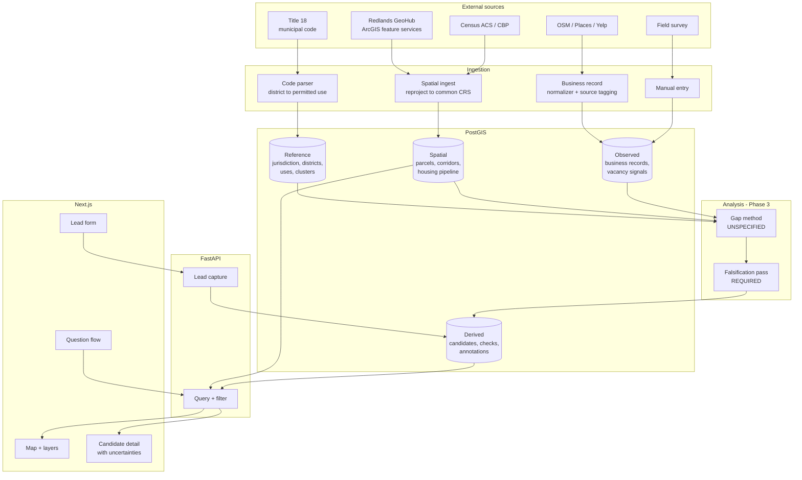

# System Architecture

Last updated: 2026-08-12

---

## Stack

| Layer | Choice | Reasoning |
|---|---|---|
| Frontend | Next.js + Tailwind | Already the Endogenation stack. No new environment to learn |
| Mapping | Leaflet via `react-leaflet` | Lightweight, no license cost, GeoJSON native |
| API | Python + FastAPI | Data processing stays in Python, where the analysis work lives |
| Database | PostgreSQL + PostGIS | Spatial queries in the database rather than in application code |
| Ingestion | Python (`geopandas`, `requests`, `osmnx`) | Same language as analysis |
| Hosting | Vercel (frontend), TBD (API + DB) | Frontend already deployed |
| Domain | `pluck.endogenation.com` | CNAME to Vercel, Squarespace DNS |

**Deliberately not chosen:** ArcGIS Online / ESRI hosted apps. Redlands publishes through ESRI and consuming those services is straightforward, but building the platform inside the ESRI ecosystem would create a dependency the project should not carry, and would make the tool harder for a non-ESRI collaborator to work on. Consume the services, do not live inside them.

---

## Data flow



---

## Ingestion notes

**Common CRS.** Everything reprojects on ingest. WGS 84 (EPSG:4326) for web delivery; California State Plane Zone 5 (EPSG:2229) if planar measurement accuracy matters for distance work. Pick one as canonical in the database and convert at the edges.

**Feature services, not downloads.** Redlands publishes live ArcGIS services. Query them rather than snapshotting where practical, but record `last_ingested` so staleness is visible. The municipal code is also a live source and has been amended recently.

**Retention constrained sources are isolated.** If Google Places terms prohibit persisting returned fields, those records cannot enter the persistent store. They are runtime lookups, flagged as such in `business_record.retention_restricted`, and any analysis depending on them is a query time cost that scales with area. **Verify before building on it.**

**Field survey is a first class input.** Walking a corridor produces `field_observed` vacancy signals and infrastructure notes that no database contains. This does not scale, which is why analysis is corridor bounded while ingestion is citywide.

---

## The analysis boundary

`D1` in the diagram is deliberately empty.

The gap methodology is specified in Phase 3, after observing the corridors. Encoding it now would freeze assumptions that have not been tested. The architecture treats analysis as a **replaceable stage with a stable interface**: it reads from the reference, spatial, and observed stores, and writes `opportunity_candidate` and `falsification_check` records. Methods can change without touching ingestion or the client.

`method_version` on every candidate exists for this reason. Results computed under different methodologies must remain attributable.

`D2` is **not** optional and does not wait for Phase 3. The requirement that surfaced opportunities carry their uncertainties, and that unknowns are marked rather than omitted, follows from Law Three and precedes any finding.

---

## Client structure

```
/                      question flow (front door)
/map                   map view, corridor default
/map?skip=true         default view, no gap inference, prompt back
/parcel/[apn]          candidate detail with checks and annotations
/help                  what help looks like, lead form
```

**Default view when the flow is skipped:** corridor with vacant zoned parcels shown, **no gap inference**, and a visible prompt back into the questions. This is honest about what the tool is. Raw layers without the question are approximately what the city already publishes, and the differentiator is the question, not the map.

**Question flow answers persist locally.** No accounts in v1. A returning visitor should not be re-interrogated.

---

## Deployment

Frontend on Vercel, auto deploying from `main` on the `Endogenator/pluck` repository.

API and database hosting undecided. Requirements: PostGIS support, and a region close enough to Vercel's edge to keep query latency reasonable. Candidates include managed Postgres with PostGIS enabled, or a container host colocated with the database.

Local `commit.bat` pushes to `main` and triggers deployment.
