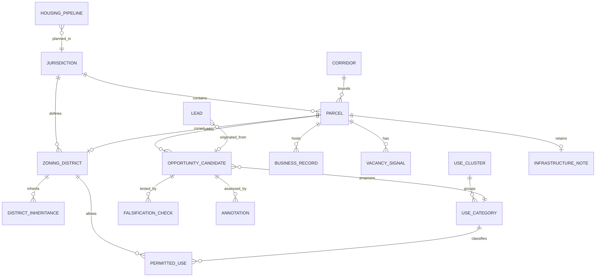

# Domain Model and Schema

Last updated: 2026-08-12

---

## Design principles

**Jurisdiction first.** A zone code is meaningless without knowing which municipal table interprets it. Every spatial record resolves to a jurisdiction. Redlands is the only jurisdiction in v1, but the abstraction exists from the outset so expansion is ingestion rather than redesign.

**Vacancy is inference, not a boolean.** No single source reliably answers whether a storefront is empty. Vacancy is modeled as accumulated signals from multiple sources, each with its own confidence, rather than a field that is true or false.

**Business records are source tagged.** Establishment data will arrive from several sources with different coverage and different biases. Records carry their provenance so a later analysis can weight or exclude by source.

**Computed and human assessments coexist.** Human judgment is recorded as annotation alongside computed values and never overwrites them. This makes the judgment layer testable over time and transmissible to others, rather than personal and lost.

**Hypotheses get nullable fields, not assumed values.** Several ideas generated during design (spatial behavior by business type, housing pipeline as demand signal) are unverified. The schema holds them so they can be tested. It does not populate them with guesses.

---

## Entity relationship

---

## Core entities

### jurisdiction

The governing authority whose code interprets a zone.

| Field | Type | Notes |
|---|---|---|
| `id` | pk | |
| `name` | text | "City of Redlands" |
| `type` | enum | `incorporated_city`, `unincorporated_county` |
| `code_title` | text | "Title 18" |
| `code_url` | text | |
| `code_current_through` | text | Ordinance reference and date |
| `last_verified` | date | Code is a live source; track staleness |

### zoning_district

| Field | Type | Notes |
|---|---|---|
| `id` | pk | |
| `jurisdiction_id` | fk | |
| `code` | text | "C-1", "C-3" |
| `name` | text | "Neighborhood Convenience Center" |
| `chapter_ref` | text | "18.88" |
| `geometry` | polygon | PostGIS |

### district_inheritance

Redlands' commercial districts are cumulative. C-3 permits everything in C-1 and C-2 plus its own additions. Modeled explicitly rather than by flattening, so the inheritance is inspectable and so the source of a permission is traceable.

| Field | Type | Notes |
|---|---|---|
| `district_id` | fk | The inheriting district |
| `inherits_from_id` | fk | The inherited district |

### use_category

A specific named use as it appears in the code. "Bakery." "Shoe repair." "Tanning salon."

| Field | Type | Notes |
|---|---|---|
| `id` | pk | |
| `name` | text | |
| `cluster_id` | fk | Q2 grouping |
| `naics_code` | text | Nullable. For joining external data |
| `spatial_behavior` | enum | **Nullable. Hypothesis, not fact.** See below |

`spatial_behavior` candidate values: `convenience` (distance minimizing, absence suggests opportunity), `comparison` (agglomerating, clustering raises demand), `destination` (agglomerating, trip is the point), `interception` (flow capture, proximity irrelevant).

**This field is deliberately unpopulated at Phase 0.** Whether these categories hold, and whether the code's own convenience goods versus shopper's goods distinction is a usable proxy for them, is an open question for Phase 3.

### use_cluster

The friendly groupings the question flow surfaces. "Food and convenience." "Personal care." "Everyday personal service."

| Field | Type | Notes |
|---|---|---|
| `id` | pk | |
| `name` | text | |
| `parent_answer` | enum | `place`, `service`, `something_else` |
| `prompt_text` | text | Q2 copy |

### permitted_use

| Field | Type | Notes |
|---|---|---|
| `district_id` | fk | |
| `use_category_id` | fk | |
| `permit_type` | enum | `by_right`, `conditional`, `commission_determination` |
| `source_ordinance` | text | |
| `notes` | text | Conditions and restrictions |

`commission_determination` captures the code's own acknowledgment that its lists are not exhaustive.

### parcel

| Field | Type | Notes |
|---|---|---|
| `id` | pk | |
| `apn` | text | Assessor parcel number |
| `jurisdiction_id` | fk | |
| `zoning_district_id` | fk | |
| `address` | text | |
| `geometry` | polygon | PostGIS |
| `area_sqft` | numeric | |
| `city_vacant_flag` | bool | As published by city. **Meaning unverified** |
| `corridor_id` | fk | Nullable |

### corridor

Bounded analysis areas. Data ingestion is citywide; analysis and ground truthing are corridor scoped.

| Field | Type | Notes |
|---|---|---|
| `id` | pk | |
| `name` | text | "State Street", "West Colton Avenue" |
| `geometry` | polygon | |
| `character` | text | Free text. Corridors are not comparable to each other |
| `ground_truthed_at` | date | Nullable |

### business_record

| Field | Type | Notes |
|---|---|---|
| `id` | pk | |
| `parcel_id` | fk | Nullable if geocoding fails |
| `name` | text | |
| `use_category_id` | fk | Nullable |
| `source` | enum | `city_license`, `osm`, `google_places`, `yelp`, `field_survey` |
| `source_id` | text | Native identifier |
| `active` | bool | |
| `first_seen` | date | |
| `last_seen` | date | Lapse without successor is a vacancy and prior failure signal |
| `retention_restricted` | bool | Flag sources that cannot be cached persistently |

`retention_restricted` exists because Google Places terms may prohibit storing most returned fields. If confirmed, those records are runtime only and must not populate a persistent layer.

### vacancy_signal

Vacancy accumulates from independent indicators rather than being asserted.

| Field | Type | Notes |
|---|---|---|
| `id` | pk | |
| `parcel_id` | fk | |
| `signal_type` | enum | `city_flag`, `no_active_license`, `license_lapsed`, `no_platform_listing`, `permit_inactive`, `field_observed` |
| `observed_at` | date | |
| `confidence` | enum | `weak`, `moderate` , `strong` |
| `notes` | text | |

`field_observed` is the strongest signal and comes from walking the corridor. It captures the sign in the window that no database contains.

### infrastructure_note

Whether a space retains fixtures from prior use. Often the largest real barrier to entry, particularly for food service.

| Field | Type | Notes |
|---|---|---|
| `parcel_id` | fk | |
| `prior_use_category_id` | fk | Nullable |
| `known_fixtures` | text[] | "hood vent", "grease trap", "walk-in" |
| `source` | enum | `permit_history`, `license_history`, `field_survey`, `submitted` |
| `verified` | bool | |

Placeholder in v1. Populated manually for corridor parcels where known. Full acquisition deferred.

### housing_pipeline

Approved or in progress residential units. Demand that has not arrived yet but has a location and a rough date.

| Field | Type | Notes |
|---|---|---|
| `id` | pk | |
| `jurisdiction_id` | fk | |
| `geometry` | point/polygon | |
| `units` | int | |
| `status` | enum | `approved`, `permitted`, `under_construction` |
| `expected_completion` | date | Nullable |

**Hypothesis, not specification.** Whether pipeline housing should enter demand calculations, and how it is spatially attributed to a corridor, is open. New units on the east side do not help West Colton if retail gravity pulls elsewhere. Captured now because it cannot be reconstructed later.

### opportunity_candidate

A computed suggestion that a use may be underrepresented at a location. **Never presented as a recommendation.**

| Field | Type | Notes |
|---|---|---|
| `id` | pk | |
| `parcel_id` | fk | |
| `use_category_id` | fk | |
| `permit_type` | enum | Inherited from permitted_use. Surfaces conditional requirements |
| `computed_at` | timestamp | |
| `method_version` | text | Methodology will change; results must be attributable |
| `raw_signal` | jsonb | Whatever the method produced |

### falsification_check

Absence is not opportunity. Every candidate carries its uncertainties.

| Field | Type | Notes |
|---|---|---|
| `candidate_id` | fk | |
| `check_type` | enum | See below |
| `result` | enum | `passed`, `failed`, `unknown` |
| `evidence` | text | |

`check_type` values: `prior_failure`, `boundary_edge_effect`, `site_barrier`, `demand_absent`, `regulatory_friction`, `cost_constraint`.

`unknown` is a **first class result**, not a null. `cost_constraint` in particular is not reliably detectable from public data and should surface as unknown rather than being silently omitted. This follows from Law Three and precedes any data.

### annotation

Human assessment recorded alongside computed values.

| Field | Type | Notes |
|---|---|---|
| `id` | pk | |
| `candidate_id` | fk | |
| `author` | text | |
| `assessment` | enum | `endorses`, `disputes`, `qualifies` |
| `reasoning` | text | **Required.** The reasoning is the artifact |
| `created_at` | timestamp | |
| `outcome_known` | bool | Set later if reality resolves it |
| `outcome_note` | text | Whether the assessment proved correct |

Annotations do not overwrite computed values. Three reasons: the record becomes testable over time, it becomes training material for other practitioners, and it makes the mentor layer replicable rather than dependent on one person.

`outcome_known` and `outcome_note` allow the data to falsify the human, not only the reverse.

### lead

| Field | Type | Notes |
|---|---|---|
| `id` | pk | |
| `candidate_id` | fk | Nullable. May arrive without a specific candidate |
| `contact` | text | |
| `message` | text | |
| `created_at` | timestamp | |

Hosted on Pluck. No external handoff, no commission, no brokered introduction.

---

## Deliberately absent

- No transaction, offer, or listing entities. Pluck is not a marketplace.
- No user accounts in v1. Question flow answers persist locally.
- No informal space entities. Deferred; adding them later does not require restructuring.
- No scoring or ranking field on `opportunity_candidate`. A single ordered score implies a recommendation, which the platform does not make.
