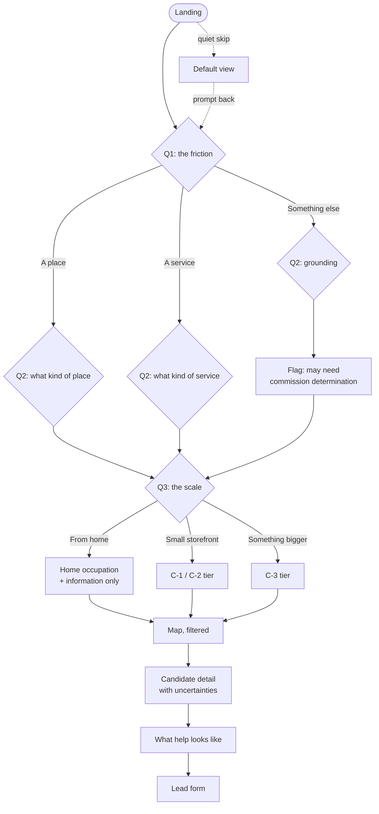

# Interaction Spec

Last updated: 2026-08-12

---

## Design premise

The user has noticed a friction. They have thought more than once that this town needs a decent bakery, or that they could run the corner place better than whoever runs it now. They have never called that thought a business idea.

The flow does not discover something new in them. It gives permission to take seriously something they already think.

Every question assumes the person knows no business or planning vocabulary and has never read a zoning map. No question asks for an industry, a business model, or a budget.

---

## Voice

Confidant, not authority. The platform never says an idea is good. It shows what is there.

Constraint on copy throughout: **observations, not suggestions.** "There is no dedicated study space within a mile of the high school," not "this would be a good location for a tutoring center." The person draws their own conclusion.

Two people looking at the same corner should be able to see different things. That is the intent, not a limitation.

---

## Flow

---

## Q1: the friction

> **What's something you wish this town had?**
> The kind of thing you've thought about more than once.

Three options: `A place` · `A service` · `Something else`

The phrasing targets friction already noticed rather than aspiration. "More than once" signals a recurring irritation, which is closer to a real market signal than a passing thought.

---

## Q2: the shape

Branches on Q1. Clusters map to actual permitted use groupings in Title 18. See `docs/data-sources.md` for the district detail.

### If "a place"

| Cluster | Contains | First permitted |
|---|---|---|
| Food and convenience | bakery, deli, specialty food market, grocery | C-1, widens at C-2 and C-3 |
| Personal care | barber, beautician, day spa, tanning | C-1 basics, C-2 day spa, C-3 tanning |
| Everyday goods | hardware, drugstore, variety, gifts, apparel | mostly C-2 |
| Larger retail | furniture, department, sporting goods, antiques | C-3 only |
| Auto related | parts and minor repair (C-2), sales and enclosed repair (C-3) | C-2 / C-3 |
| Recreation and entertainment | gyms, theaters, social halls, hotels | C-3 only |

### If "a service"

| Cluster | Contains | First permitted |
|---|---|---|
| Everyday personal service | laundromat, dry cleaner, shoe repair, tailor | C-1 laundromat and shoe repair, C-2 cleaner, C-3 tailor |
| Professional and office | general business or professional office | **conditional in C-1**, by right in C-3 |
| Financial | branch bank (C-2), full financial services (C-3) | C-2 / C-3 |
| Studios and schools | martial arts (C-2), dance, art, music, language (C-3) | C-2 / C-3 |
| Food service | restaurant (C-2), with alcohol and catering (C-3) | C-2 / C-3 |

The professional office case is worth surfacing to the user directly, since the platform can tell them something they would not have known to ask: an office here needs a conditional use permit, three blocks over it does not.

### If "something else"

Does not map cleanly, by design. This mirrors the code's own *similar uses by commission determination* provision in C-2 and C-3, which is an acknowledgment that the list cannot anticipate everything.

Q2 asks a grounding question (does it involve making something, storing something, or something not named here), then tells the person honestly that this may require a specific determination from the city rather than a lookup. That is accurate information they would not otherwise have.

---

## Q3: the scale

> **Do you picture this as something you'd run from home, a small storefront, or something bigger, like downtown?**

Three options: `From home` · `A small storefront` · `Something bigger, like downtown`

This asks about footprint and zoning tier without using either word. It resolves to:

| Answer | Resolves to | Notes |
|---|---|---|
| From home | Home occupation permit territory | Likely information only, few or no map results |
| A small storefront | C-1 / C-2 | Smaller parcels, neighborhood scale |
| Something bigger, like downtown | C-3 | Larger footprints, higher foot traffic |

---

## Arrival

> **Here's what's actually there.**

Not a question. The transition into the map. No interpretation attached.

---

## Map view

- Corridor scoped by default (State Street, West Colton Avenue)
- Layers: zoning, vacant zoned parcels, existing businesses, candidates
- Filter by cluster and by named use
- Candidates shown with permit type surfaced (by right versus conditional)

---

## Candidate detail

The most important screen in the product, because it is where Law Three is either honored or not.

Shows, in this order:

1. **What is permitted here.** Named use, district, permit type. The most certain information available, and therefore first.
2. **What is present.** Existing businesses of this type within the relevant area.
3. **What the analysis found.** Whatever the Phase 3 methodology produces, labeled as inference.
4. **What is uncertain.** Falsification checks with results, including `unknown` states shown explicitly rather than omitted. Cost as a constraint is not reliably detectable from public data and says so.
5. **What a person thinks.** Human annotations with reasoning, alongside the computed values, never replacing them.

**No ranking, no score, no recommendation.** A single ordered score would imply the platform has judged viability. It has not.

---

## Default view (flow skipped)

Corridor with vacant zoned parcels shown. **No gap inference.** Visible prompt back into the question flow.

This is deliberate. Raw layers without the question are approximately what the city already publishes, and the differentiator is the question, not the map. The default view is honest that the useful version requires the person to say something.

The skip link is quiet, not prominent.

---

## Lead capture

Reached from the candidate detail through a "what help looks like" page.

**Shows rather than sells.** Describes what the support actually is: sequencing permits, negotiating a lease, knowing what a landlord needs to hear. Not a pitch.

Form hosted on Pluck. No outbound link, because a context switch at the moment of maximum motivation loses people. No commission, no brokered introduction, no fee.

Captures: contact, message, and the candidate it originated from if any.

---

## State

No accounts in v1. Question flow answers persist locally so a returning visitor is not re-interrogated. Answers are a filter, not a profile.
